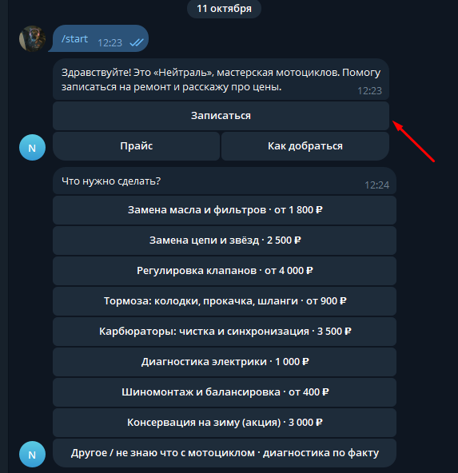
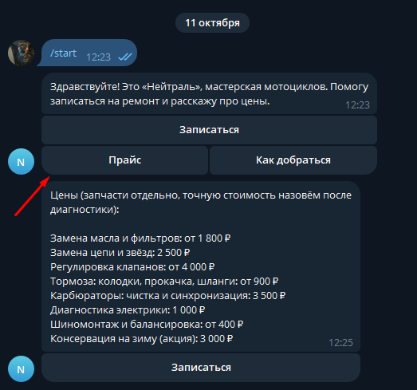
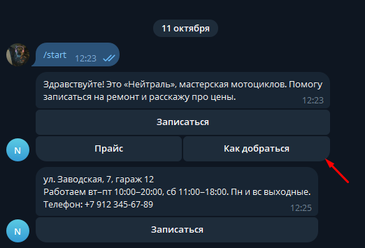
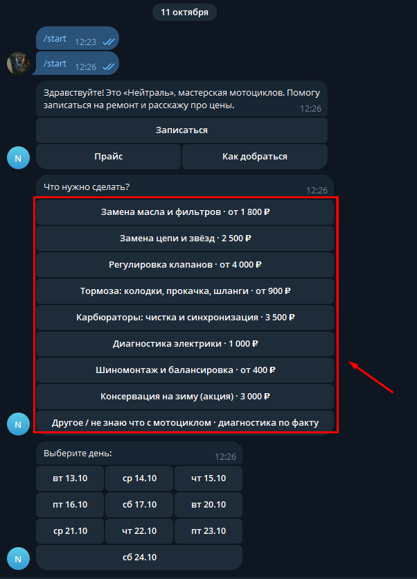
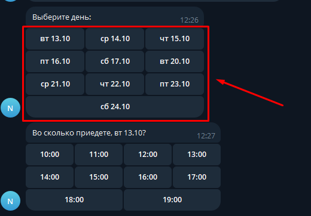
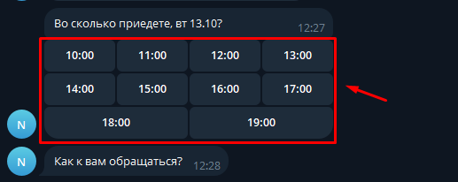
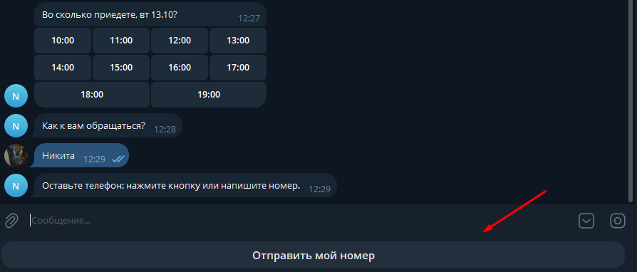
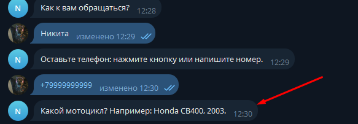
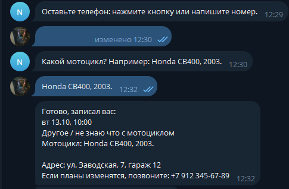
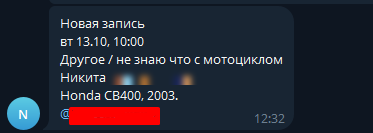

# Бот записи для мотомастерской «Нейтраль»

Телеграм-бот, через который клиент записывается на ремонт мотоцикла: выбирает услугу, день и время, оставляет имя, телефон и модель. Мастер получает готовую заявку в Телеграм, а занятые часы другим клиентам больше не предлагаются.

Демо-проект: мастерская вымышленная, в паре с сайтом [«Нейтраль»](https://github.com/shizofrenics/neutral).

## Как это выглядит

Клиент пишет `/start`, видит меню, может открыть прайс и адрес или записаться:

| Меню | Прайс | Как добраться |
|---|---|---|
|  |  |  |

Запись: услуга, день, время (уже занятые часы скрываются):

| Услуга и день | Время |
|---|---|
|  |  |

Контакты клиента: имя, телефон (можно кнопкой «Отправить мой номер») и мотоцикл:

| Имя | Телефон | Мотоцикл |
|---|---|---|
|  |  |  |

Клиент получает подтверждение, а владелец мастерской сразу получает уведомление о новой записи:

| Подтверждение клиенту | Сообщение владельцу |
|---|---|
|  |  |

## Что умеет

- запись по дням и часам по графику мастерской (вт–пт 10–20, сб 11–18);
- защита от двойной записи на одно время;
- проверка телефона и уведомление владельцу;
- команды `/price`, `/where`, `/cancel`, для владельца ещё `/list` со списком записей;
- записи сохраняются в `bookings.json`.

Написан на чистом Python 3.8+, только стандартная библиотека, ничего устанавливать не нужно.

## Запуск

1. Получите токен у @BotFather командой `/newbot`.
2. Скопируйте `config.example.env` в `config.env` и впишите токен. В `ADMIN_CHAT_ID` укажите свой Id (его покажет @userinfobot), чтобы заявки приходили вам.
3. Запустите `python bot.py` (в Windows: двойной щелчок по `start.bat`).

Адрес, телефон, график и список услуг меняются в начале `bot.py`. Файлы `config.env` и `bookings.json` в репозиторий не попадают.
